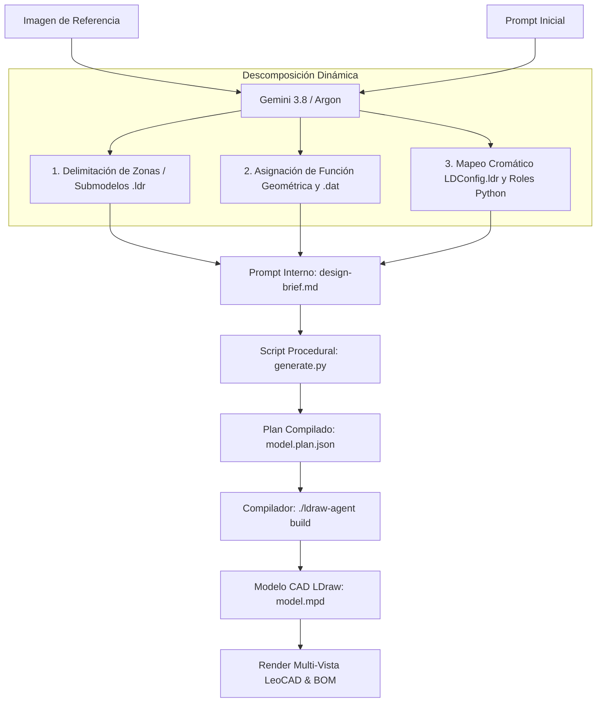

# Estrategia de Descomposición Dinámica de Visión por Submodelos LDraw

## 1. Fundamento y Objetivo
En **ldraw-nova**, la generación de modelos LEGO© a partir de referencias visuales no utiliza una lista fija ni predeterminada de piezas ni submodelos. Cada imagen analizada presenta características morfológicas, cromáticas y de escala únicas.

El modelo multimodal de lenguaje y visión (**Gemini 3.8 Flash / Gemini 4 Argon**) actúa como un **arquitecto CAD LDraw**:
1. **Segmenta dinámicamente** la imagen en zonas u objetos concretos y diferenciados (submodelos `.ldr`).
2. **Asigna la función geométrica** (soporte de peana, técnica SNOT, escalado por capas, caída curva, rejillas, biseles, etc.).
3. **Resuelve las piezas oficiales LDraw (`.dat`)** disponibles en la biblioteca oficial de LDraw.
4. **Vincula la paleta cromática (`LDConfig.ldr`)**, asignando a cada zona su código numérico exacto y su rol en el generador procedimental Python (`generate.py`).

---

## 2. Flujo del Pipeline Dinámico

---

## 3. Estructura del Prompt Interno Dinámico (`design-brief.md`)

Para cualquier imagen procesada, el pipeline genera dinámicamente dos tablas centrales:

### Tabla 1: Piezas LDraw por Submodelo (`.dat`)
Mapea cada zona a su función de ingeniería y sus piezas correspondientes:

| Submodelo / Zona | Función Geometría | Pieza Oficial LEGO / LDraw | LDraw ID (`.dat`) |
|---|---|---|---|
| *Zona A* | *Técnica (ej. SNOT, bisel, curvatura, soporte)* | *Nombre Oficial de la pieza* | `xxxx.dat` |
| *Zona B* | *Técnica* | *Nombre Oficial de la pieza* | `yyyy.dat` |

### Tabla 2: Paleta Oficial de Colores (`LDConfig.ldr`)
Establece los códigos enteros de color y su uso en el script procedimental:

| Zona del Modelo | Nombre Oficial LDraw | Código LDraw | Uso específico en el script Python (`generate.py`) |
|---|---|---|---|
| *Zona A* | *Nombre LDraw* | *Código* | *Instrucción para el ensamblador procedimental* |
| *Zona B* | *Nombre LDraw* | *Código* | *Instrucción para el ensamblador procedimental* |

---

## 4. Ejemplos de Descomposición por Naturaleza de la Imagen

### Caso A: Escultura / Busto Anatómico (Retrato)
* **Zonas identificadas:** Pedestal de apoyo, Hombros/Jersey, Cuello/Mandíbula, Barba/Bigote SNOT, Rostro/Facciones, Cabello superior.
* **Piezas geométricas clave:** Brackets SNOT `99781.dat` / `87087.dat`, Cheese slopes `54200.dat`, Rejillas `2412b.dat`, Slopes curvados `11477.dat`.
* **Colores:** Dark Blue `272`, Tan `19`, Light Nougat `78`, Dark Bluish Gray `72`, Black `0`, Reddish Brown `70`.

### Caso B: Arquitectura y Dioramas
* **Zonas identificadas:** Plataforma base/terreno, Fachada y cerramientos, Cubiertas/Tejados, Jardín/Piscina.
* **Piezas geométricas clave:** Baseplate `4186.dat`, Muros `3004.dat` / `3010.dat`, Slopes 33° `4161.dat`, Frondas de palmera `2518.dat`, Tiles translúcidos `3068b.dat`.
* **Colores:** White `15`, Tan `19`, Trans-Light-Blue `43`, Green `2`, Dark-Green `288`, Dark Orange `484`.

### Caso C: Vehículos y Maquinaria
* **Zonas identificadas:** Chasis inferior, Ejes y tren de rodaje, Cabina/Habitáculo, Carrocería exterior, Ópticas.
* **Piezas geométricas clave:** Plates modificados con rodamiento `2415.dat`, Bricks Technic con orificios `3700.dat`, Asiento `4079.dat`, Parabrisas `60594.dat`.
* **Colores:** Red `4`, Black `0`, Flat Silver `179`, Dark Bluish Gray `72`.

---

## 5. Garantía de Resiliencia (Fallback Contextual)
Si la conexión con la API externa reporta restricciones de cuota o indisponibilidad temporal (como el código `402` por agotamiento de créditos prepago), el backend ejecuta un **motor de segmentación visual contextual local**. Este analiza los contrastes morfológicos y la distribución de color espacial de la imagen para producir igualmente un desglose dinámico coherente en piezas LDraw y códigos `LDConfig.ldr`.
